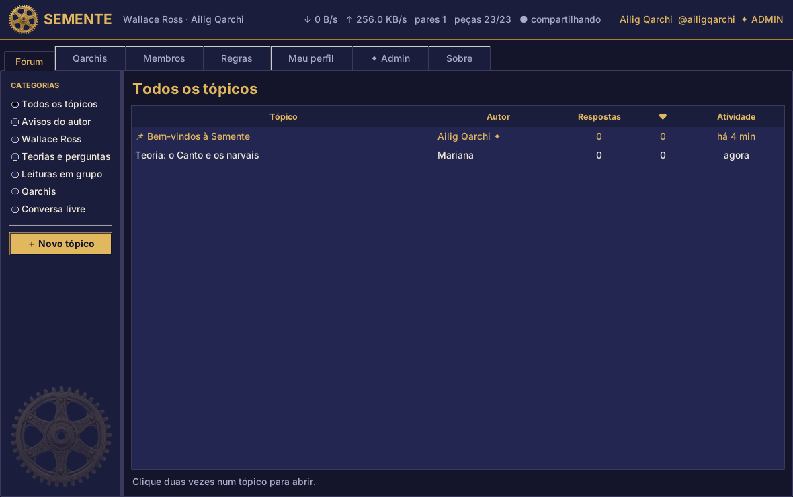

# Semente

O fórum dos leitores de **Wallace Ross**, de Ailig Qarchi: um `.exe` que os leitores baixam e que se conecta ao **servidor que o autor mantém ligado**. É um app cliente comum — os leitores conversam, e o autor disponibiliza as amostras (**qarchis**) a partir do seu próprio servidor.



## Como funciona

- **O autor roda o servidor.** Numa máquina sempre ligada (o laptop do autor, ou um servidor gratuito como o Oracle Cloud Always Free), o autor roda `Semente.exe --servidor`. Isso baixa e sobe um **PocketBase** — um servidor pronto, de um projeto open-source no GitHub — com o fórum, as contas e os arquivos.
- **Os leitores usam o cliente.** Cada leitor baixa o `Semente.exe`, abre, e o app se conecta ao servidor do autor pela internet (em `sementes.ailigqarchi.com.br`). Quando o servidor está no ar, a Semente acorda; quando não está, ela avisa e o leitor tenta mais tarde. Nada se instala ou se espalha sozinho entre as máquinas dos leitores: é só um cliente que se conecta a um endereço.
- **O próprio servidor garante as regras.** Ninguém posta estando banido, ninguém se passa por outra pessoa e só o autor aprova, apaga, bane e muda as regras. Isso é imposto pelas regras de acesso do servidor, não só pela tela.

## O que a pessoa encontra ao abrir o Semente.exe

| Aba | O que faz |
|---|---|
| **Entrar / Criar conta** | Cadastro com usuário e senha, guardados no servidor. Dá para entrar de qualquer computador. |
| **Fórum** | Categorias, tópicos, respostas, curtidas, tópicos fixados e aviso do autor no topo. Os posts do autor levam o selo ✦ AUTOR. |
| **Qarchis** | Os conjuntos de arquivos que o autor disponibiliza (as amostras do livro, por exemplo). O leitor baixa do servidor para o seu computador. |
| **Membros** | Quem participa do fórum. O autor aprova, reprova, remove e readmite por aqui. |
| **Regras** | As regras do fórum. Só o autor edita: texto, categorias, "só aprovados podem postar" e "membros podem enviar qarchis". |
| **Meu perfil** | Nome, "sobre", trocar a senha, sair da conta e o endereço do servidor. |
| **✦ Admin** | Só para o autor: aprovar ou recusar qarchis e publicar o aviso do topo. |

## Para o autor: colocar no ar

### 1. Suba o servidor

Numa máquina que vá ficar ligada, rode:

```
Semente.exe --servidor                     # Windows
python3 -m semente --servidor              # a partir do código, na pasta app
```

Na primeira vez, o app:

- baixa o PocketBase certo para o sistema (uma vez só);
- cria as contas e as coleções do fórum;
- gera as senhas e as guarda em `…/Semente_Wallace_Ross/servidor/SENHAS-GUARDE-BEM.txt`
  (ou usa as que você passar nas variáveis `SEMENTE_ADMIN_SENHA` e `SEMENTE_AUTOR_SENHA`);
- fica servindo em `http://127.0.0.1:8090`.

Guarde o arquivo de senhas num lugar seguro. Dentro dele:
- **PAINEL_POCKETBASE_SENHA** é para o painel de administração do servidor, em `http://127.0.0.1:8090/_/`.
- **AUTOR_SENHA** é a senha do usuário `ailigqarchi`, com que você entra **no app** como autor (admin do fórum).

### 2. Exponha o servidor na internet (Cloudflare Tunnel)

O jeito recomendado, gratuito e sem abrir portas no roteador, é o **Cloudflare Tunnel**:

1. Crie uma conta gratuita na Cloudflare e aponte o DNS do domínio `ailigqarchi.com.br` para ela (ou só delegue o subdomínio `sementes`).
2. Instale o `cloudflared` na máquina do servidor e rode:
   ```
   cloudflared tunnel login
   cloudflared tunnel create semente
   cloudflared tunnel route dns semente sementes.ailigqarchi.com.br
   cloudflared tunnel run --url http://127.0.0.1:8090 semente
   ```
3. Pronto: `https://sementes.ailigqarchi.com.br` passa a levar ao seu servidor, mesmo que o IP da sua casa mude, e sem mexer no roteador.

Alternativa sem túnel: redirecione uma porta no roteador para a máquina e crie um registro **A** (ou um **CNAME** para DuckDNS/No-IP) em `sementes`. O túnel é mais simples e mais seguro.

O endereço que o app usa está em `app/semente/config.py` (`SERVIDOR`). Para testar contra um servidor local, defina a variável de ambiente `SEMENTE_SERVIDOR`, por exemplo `http://127.0.0.1:8090`.

### 3. Deixar sempre no ar (opcional)

Para a Semente não depender do seu laptop estar aberto, rode o mesmo `--servidor` numa máquina sempre ligada (Oracle Cloud Always Free serve). O app não muda: só o endereço por trás de `sementes.ailigqarchi.com.br` passa a apontar para lá.

### 4. O resto

- **Pegue o .exe.** Cada push gera o `Semente.exe` em *Actions → Semente.exe → Artifacts*. Uma tag `v1.0` publica o .exe na página *Releases*.
- **Site.** Suba a pasta `site/` para ailigqarchi.com.br.
- **Amostras.** Entre no app como `ailigqarchi` e use a aba **Qarchis → Enviar qarchi** para publicar as amostras. Elas ficam disponíveis para todos os leitores baixarem.
- **Livro na Amazon.** Quando sair, preencha `AMAZON` em `config.py`.

## Rodar a partir do código

```
cd app
python -m semente                 # janela (cliente)
python -m semente --servidor      # servidor (para o autor)
```

Precisa de Python 3.9+ com Tkinter para a janela. Não há dependências externas (só a biblioteca padrão); o PocketBase é baixado pelo modo servidor.

## Limites conhecidos

- A Semente só funciona quando o servidor do autor está no ar. Se o laptop estiver desligado, o app avisa e o leitor tenta mais tarde.
- Contas novas são fáceis de criar. Contra abuso, o autor pode ligar "só membros aprovados podem postar" nas Regras.
- As traduções das amostras (en, es, zh, hi, ar) foram feitas com ajuda de IA e merecem revisão humana.

## Pastas

- `app/semente/`: o código. `api.py` fala com o servidor, `nucleo.py` tem as ações e monta o fórum, `janela.py` é a interface e `servidor.py` sobe o PocketBase no modo `--servidor`.
- `site/`: o site de arquivo único e as amostras.
- `traducoes/`: os textos traduzidos e o gerador dos PDF/EPUB.
- `docs/telas/`: capturas de tela.
